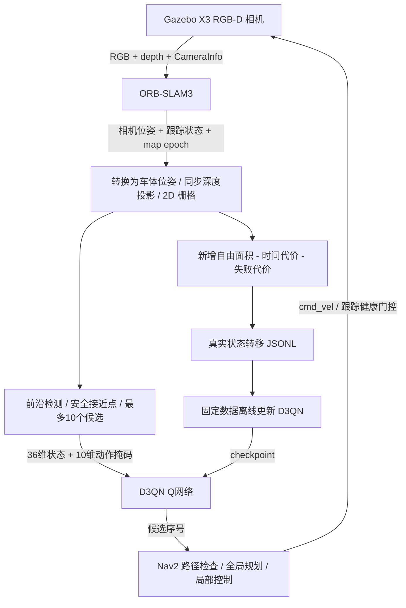

# X3 D3QN Active SLAM

用于学习 **ORB-SLAM3 + 强化学习上层决策 + Nav2 + Gazebo Fortress** 的工程案例。采用“先自主采集，再用固定数据集训练 D3QN，最后加载模型在仿真中探索”的流程。默认不保存录像。

**定位：这是参考 ExplORB-SLAM-Dueling-DDQN 思路的工程改造，不是原论文的严格复现，也不代表模型已收敛。** 使用 ORB-SLAM3、ROS 2 Humble、Nav2 和自行定义的 36 维状态；奖励和状态中的信息增益采用局部地图代理量，不是原文完整的不确定性度量。

## 目录

| 目录 | 内容 |
|---|---|
| `runtime/` | ROS RGB-D / ORB-SLAM3 C++ 封装 |
| `third_party/ORB_SLAM3/` | 从运行服务器导出的修改版 ORB-SLAM3 源码及原许可证，不含库文件 |
| `config/`, `worlds/` | 相机标定、X3 模型描述、室内仿真世界；外部网格不打包 |
| `exploration/` | 位姿转换、深度栅格地图、前沿候选、Nav2、同步 Gym 环境 |
| `learning/` | 采集、Dueling Double DQN、离线训练、推理、可选实时预览 |
| `scripts/` | 容器入口、编译、采集→训练→评估统一入口 |
| `deploy/l20/` | Ubuntu 22.04 / ROS Humble / Fortress 镜像构建文件 |
| `docs/` | 数据接口、运行边界与来源说明 |

## 完整闭环



采集阶段由带随机性的启发式策略自己选择目标，不需要遥控，不更新网络。训练阶段读取固定 JSONL，不运行 Gazebo。推理阶段加载一次权重，不更新参数。详见 [数据接口](docs/architecture.md)。

## 环境与外部资源

- Linux x86_64、Docker、NVIDIA Container Toolkit / CDI，GPU 渲染设备默认 `nvidia.com/gpu=0`。
- 已运行环境：Ubuntu 24.04 宿主机，容器 Ubuntu 22.04 / ROS 2 Humble / Gazebo Fortress，L20；网络训练实际使用 CPU 版 PyTorch，GPU 主要用于相机渲染。
- 当前导出不包含大型词典、X3 网格、场景纹理、训练集、权重、Docker 镜像。将已有 X3 工程路径设为 `ASLAM_ASSETS_ROOT`，需要该路径下的 `worlds/assets/`、`third_party/x3-robodog2/`、`Vocabulary/ORBvoc.txt`。
- ORB 词典可从 [ORB-SLAM3 官方仓库](https://github.com/UZ-SLAMLab/ORB_SLAM3/tree/master/Vocabulary) 获取并解压。X3 / 场景资源需自行准备，并遵循各自许可。仅克隆本仓库还不能直接启动完整房屋仿真。

## 在现有服务器上运行

所有命令在 Linux 上从仓库根目录执行。不要复用正在运行任务的输出目录。

```bash
cp .env.example .env
# 编辑 .env 中的 ASLAM_RESULTS_ROOT 与 ASLAM_ASSETS_ROOT
docker build -t x3-aslam:local deploy/l20
bash scripts/container.sh bash scripts/build_runtime.sh

# 先确认数值和几何检查通过
bash scripts/container.sh python3 learning/test_learner.py
bash scripts/container.sh python3 exploration/test_frontiers.py

# 默认4实例，各采集250条，上限8小时；随后训练10000次并做短程验证
bash scripts/container.sh python3 scripts/pipeline.py \
  --output /results/run_001 --actors 4 --samples-per-actor 250 --updates 10000
```

可将 `.env` 的镜像名设为已有且兼容的 `x3-explorb-d3qn:20261106`，跳过镜像构建。仍应重新编译本仓库导出的 ORB / wrapper，避免库与头文件不一致。新增整合镜像的冷启动构建尚未完成端到端验收。

后台运行可使用服务器已有的 `tmux` / `screen`，或：

```bash
nohup bash scripts/container.sh python3 scripts/pipeline.py \
  --output /results/run_002 --actors 4 > pipeline-console.log 2>&1 < /dev/null &
```

`pipeline.json` 报告当前阶段和失败原因；采集配额或时间上限结束后，至少有8条样本才开始训练。采集未达配额时可能用较少数据训练，应检查 `samples`。训练完成后写出 `offline/d3qn_offline.pt`，再运行短程验证；进程结束后 Docker 容器自动删除，输出保留。不会关闭服务器或其他人的进程。

只训练已有数据：

```bash
bash scripts/container.sh python3 learning/train_offline.py \
  --dataset /results/run_001/transitions.jsonl --output /results/retrain --updates 10000
```

`--resume` 载入策略并恢复更新计数，但优化器状态和目标网络滞后状态不会完整恢复，不能视为严格续训。长程探索使用 `learning/explore_full.py`，需显式设置 `X3_VIEW_ROOT` 为已有可写目录；`learning/record_simulation.py` / `live.html` 提供可选预览组件，统一入口默认不启动预览服务。

## 训练监控与效果比较

统一入口现已默认启用每2500次更新的独立仿真验证、初始与中间检查点保留、训练后四组策略对照，以及 `monitor/index.html` 曲线报告。记录 loss、TD 误差、Q 值、梯度，展示独立评估回报、面积、导航成功率和中断次数。验证会增加流程耗时；不会用 loss 下降或更新次数宣称收敛。具体运行方式、统计口径和最佳模型选择见 [评估说明](docs/evaluation.md)。

## 当前边界

- 固定数据训练属于 D3QN 预训练，没有 CQL 等保守离线 RL 机制；训练损失下降不等于探索能力收敛。
- 地图是局部有界栅格；回环引起全局修正时清除旧地图/候选并取消旧目标，尚非完整长期全局地图重建。
- X3 使用仿真速度控制，不是完整轮胎/电机动力学验证。短程导航成功不代表全屋覆盖或实车可迁移。
- 8 个实例是否稳定受 CPU、内存、渲染与进程数量共同限制；默认4个，不承诺8个稳定。
- 导出后的基础接口和数值测试与完整冷启动部署是不同层级的验证。具体核验见 [验证记录](docs/validation.md)。

## 论文与代码来源

- [原作者代码](https://github.com/LiXin0123/ExplORB-SLAM-Dueling-DDQN)，参考版本 `1fa60103c9b6632419d65f965414612f9a14aa1f`。
- [论文 PDF](https://eprints.gla.ac.uk/375587/3/375587.pdf)，DOI `10.1109/ICRAE64368.2024.10851611`。
- [ORB-SLAM3 官方项目](https://github.com/UZ-SLAMLab/ORB_SLAM3)。本仓库保留的核心是服务器修改版快照，不是官方原版的无修改副本；原始提交号无法从服务器恢复。

许可证范围见 [THIRD_PARTY_NOTICES.md](THIRD_PARTY_NOTICES.md)。不要将所有目录统一理解为自行原创或统一的 MIT 授权。
